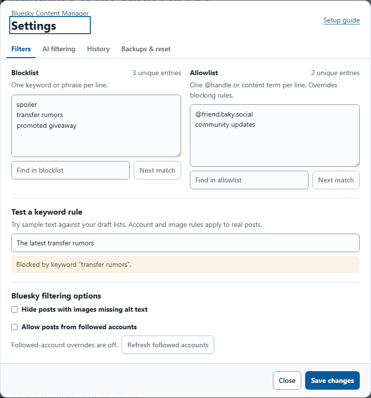

# Bluesky Content Manager

Filter Bluesky by keyword, phrase, account, or image alt text. Version 4.0 adds the settings layout used by Reddit Advanced Content Filter and optional AI topic filtering. AI starts off on a standard upgrade or fresh install.

## Quick start

1. Open **Configure Filters** in your userscript manager while on Bluesky.
2. On **Filters**, enter one item per line. The blocklist checks words and phrases. The allowlist accepts `@handles` and content terms and takes priority over blocking.
3. Use **Test a keyword rule** to try the draft lists, then choose **Save changes**.

Single words match whole words and common English plurals. For example, `city` matches `cities`. Add irregular forms and verb forms separately if you want them matched. Multiword phrases match substrings and treat spaces, dashes, and underscores as equivalent separators. Matching also normalizes fullwidth letters and invisible word-splitting characters.

Bluesky-specific options include hiding posts with missing image alt text and allowing posts from followed accounts. Followed-account overrides use Bluesky's public follows endpoint and the active account. Filtering pauses while the first follows list loads. Avatars, banners, small icons, and decorative images are excluded from missing-alt-text enforcement.

## Optional AI filtering

In **AI filtering**, enter one topic per line, save an OpenRouter key, choose a feed scope, and enable AI. Start with **Preview** to label matches while keeping posts visible. **Hide** removes matches. Use **Keep this post** on a preview to save an override for that post's current content and account. The default scope is the News feed by aendra.com. The wider scope covers supported home, profile, and custom feeds.

AI sends eligible public feed text, article previews, link paths, image descriptions, and your topics through OpenRouter for classification. Enable it only for feeds you are comfortable sharing. With **Scan attached pictures** enabled, eligible public Bluesky pictures and thumbnails are sent through OpenRouter to Gemini 2.5 Flash-Lite. Liquid d1-ultra Latest receives descriptions and text for the final decision. The API key goes to OpenRouter. Optional AI uses neither Bluesky login tokens nor full articles.

Visible posts take priority. Checks can include nearby loaded posts, so lookahead can use part of the daily allowance on posts you never view. Under **Advanced options**, set the daily budget and request limit, which reset at midnight UTC. Both model stages count toward the limits. For a firm spending cap, set a limit on the OpenRouter key. Uncertain results and unsuccessful scans leave posts visible.

## History and backups

- **History** separates posts blocked in the current session from AI matches. Reloading clears session history.
- **Backups & reset** lets you export settings or load a backup for review before saving. Backups from the original Bluesky Content Manager and the separate AI build use the same supported format. They exclude the OpenRouter key.
- Updating the existing Greasy Fork installation retains saved filters. To move preferences from the separate AI build, export there, import the backup in v4.0, and save. Enter the OpenRouter key in the new installation if needed.
- **Clear remembered blocks** resets the local keyword and alt-text decisions. **Clear AI memory and Keep overrides** resets cached AI decisions and Keep overrides while retaining daily usage.
