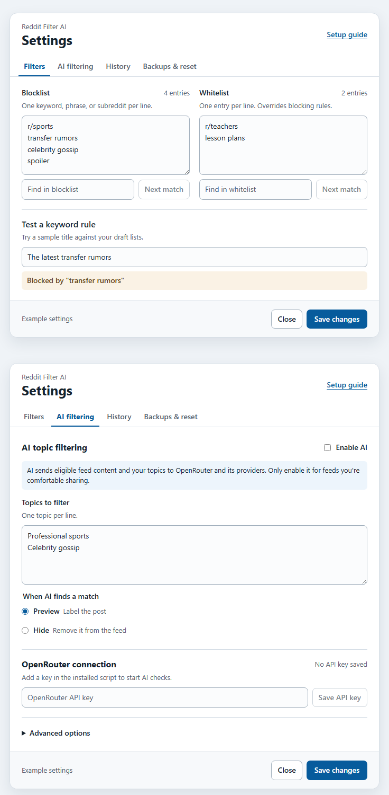

# Reddit Advanced Content Filter

Use keyword and subreddit rules to filter Reddit. You can also enable AI topic filtering through OpenRouter and optionally include pictures. AI starts off. The script works on www.reddit.com and old.reddit.com.

## Quick start

1. On Reddit, open your userscript manager's **Configure Reddit Filter** command.
2. In **Filters**, add keywords, phrases, or subreddit names to the blocklist and whitelist. Enter one item per line. Use **Test a keyword rule** to try a title before saving.
3. To try AI, open **AI filtering**, save an OpenRouter API key, enter one topic per line, and turn on **Enable AI**. Start with **Preview** to label matches while keeping the posts visible. Choose **Hide** to remove matched posts from the feed.
4. Choose **Save changes** to apply the draft. **Save API key** and **Remove API key** update the connection separately. Your key is stored by the userscript manager and excluded from backups.

If you update an existing installation from version 3.2.0, your saved blocklist and whitelist carry over. AI filtering starts off for that upgrade.

## How rules match

- The whitelist takes priority and can bypass both keyword and AI filtering. Keyword and subreddit blocks run before AI.
- Use `news` or `r/news` for a subreddit. **Test a keyword rule** checks sample text only. Subreddit metadata is checked on real posts.
- Single words match whole words and common regular English plurals. `city` matches `cities`, and `cat` does not match `cater`. Enter irregular forms separately.
- Phrases match substrings. For example, `transfer rumors` also matches `transfer-rumors` and `transfer_rumors`. Fullwidth letters and invisible word-splitting characters are normalized.
- Relevant article previews, link paths, and image descriptions can contribute evidence. The script excludes link queries and fragments and does not download full articles.

## AI and privacy

Liquid d1-ultra Latest checks whether a post is mainly about one of your topics. It can catch related wording, and incidental mentions are meant to stay visible. Scores are model estimates. Errors, insufficient evidence, and uncertain decisions leave posts visible.

AI scans eligible cards on home and subreddit feeds. Comments, profiles, search, chat, and messages are outside that scope. Known private community cards are skipped. Feed cards without privacy metadata may still be sent, so enable AI only for feeds you are comfortable sharing.

When AI is enabled, eligible post text, article previews, link paths, and your topics are sent through OpenRouter to its provider. With **Scan attached pictures** enabled, Gemini 2.5 Flash-Lite can receive up to four pictures from permitted Reddit image hosts, including eligible thumbnails and video posters. Avatars and private image URLs are excluded. Gemini receives the pictures and returns descriptions. Liquid receives the post text and picture descriptions and makes the filtering decision. Video playback, full articles, and Reddit login tokens are excluded. Your API key is sent only to OpenRouter and must permit both models if picture scanning is enabled.

Checks prioritize visible cards and can look ahead up to two screens below and one screen above. This can spend part of the daily allowance on posts you never view. Fast scrolling, slow responses, and limits can leave some posts unchecked. The script works with already-loaded cards and does not fetch additional Reddit pages for lookahead. Checks pause while settings are open.

## Limits and spending

- **Daily budget** and **Daily request limit** reset at midnight UTC. The budget is divided equally between www and Old Reddit, and unused shares do not transfer. An odd request limit gives www one extra request. A limit of 1 leaves Old Reddit with zero requests.
- A Gemini picture scan reserves $0.005. A Liquid request reserves $0.005 per included post. The script reconciles reservations when OpenRouter reports costs. Failed attempts or missing cost reports can retain the reservation for the day. Both stages count toward the daily request limit.
- Text-only requests can group up to three posts. Picture posts use Gemini first, then Liquid. An incomplete or failed picture scan keeps that post visible.
- Tabs on the same Reddit address coordinate requests. Provider pauses are shared between www and Old Reddit, although requests on both addresses can start at the same time. Local limits are best effort. Set an OpenRouter key spending limit for a firm account cap.

## History, backups, and reset

- **History > Blocked posts** shows posts hidden during this page session, even if the rules later change. Search by title, subreddit, or reason. **AI matches** also shows posts labeled in Preview and identifies the AI topic, estimated score, model, and rules checked. The model does not provide evidence quotes. Reloading clears session history.
- **Export settings** includes the current draft lists and AI preferences. **Import settings** stages the lists and preferences for review. Backups from the original Reddit filter can import lists into this edition. Choose **Save changes** to apply the import.
- **Clear remembered blocks** clears the local keyword and subreddit decision cache. It stores up to 5,000 recent blocks for 30 days and rechecks changed content or lists. It keeps your rules and session history. Post bodies are not stored in this cache.
- **Clear AI memory and Keep overrides** clears saved AI decisions and Keep overrides for the current Reddit address, and retains daily usage. AI decisions are cached locally for up to seven days and 1,000 entries. Picture descriptions are kept for the page session. Remembered AI decisions and Keep overrides are separate for www and Old Reddit.

## Troubleshooting

- **AI is idle.** Check that you saved a valid OpenRouter key, entered topics, turned on AI, and saved the settings. Close the panel to resume checks. If you reached your daily share, check the usage on your current Reddit address.
- **OpenRouter is busy.** The script pauses after a rate limit and retries automatically. **Retry AI checks** is available under **Advanced options**. Checks resume after you close settings.
- **A picture check failed.** Make sure the OpenRouter key permits both models. A failed scan leaves the post visible, and other posts can still be checked.
- **Settings changed in another tab.** Export your current draft if you want a copy, then close and reopen settings to load the latest saved version.
